# Entity relationship diagrams

## Processing fabric flow addition (2026-10-27)

[Simple fabric flows](PROCESSING_FABRIC_FLOW.md) add `processing_fabric_flows`
with a unique request UUID, canonical input hash, JSON evidence, draft/posted status,
creator FK and nullable unique document/onward-document FKs. CHECKs require posted
flows to have a document and onward links to belong to inbound flows. Existing
Processing, stock and journal schemas and old payload hashes are unchanged.
`ProcessingFabricSetupSeeder` adds the per-suit embroidery service without changing
existing piece-rate contracts. No component count is an independent stock balance.

## Phase 12 implemented finance relationships (2026-10-26)

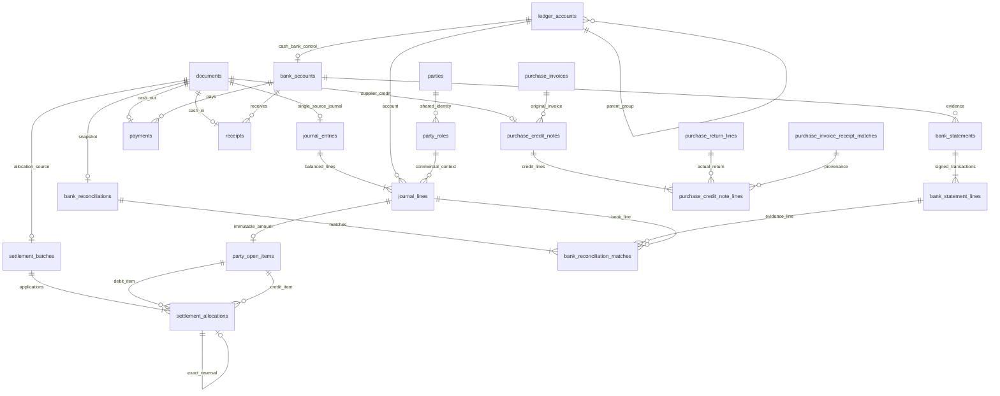

Reports are projections, not separate editable ledgers. Existing source modules
retain document identity. See [ACCOUNTING_FINANCE.md](ACCOUNTING_FINANCE.md).

## Phase 11 implemented Wholesale relationships (2026-10-26)

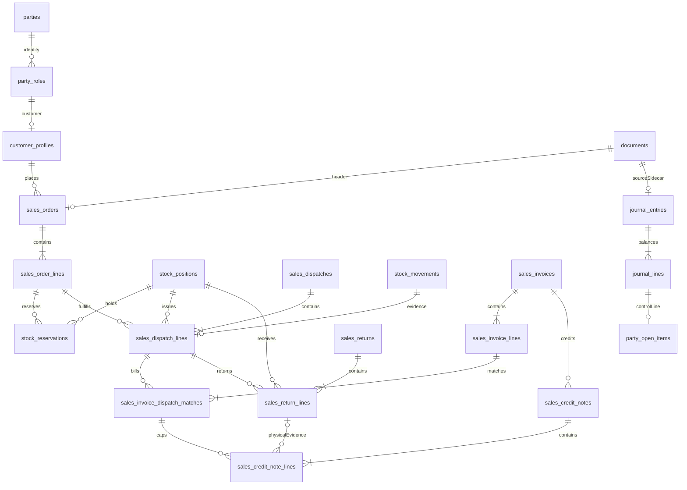

The nullable reservation FK also enforces its order document through a composite
parent FK. All source headers share documents; stock/value genealogy uses existing
Inventory allocations/cost links. No duplicated customer, stock or AR master. Tax
children and settlements remain future. Detailed slice: [SALES.md](SALES.md).

## Implemented Phase 10 packing relationships (2026-10-26)

These are actual migration FKs. Package/content rows represent physical provenance,
not a second stock total. See [FINISHED_GOODS_COSTING.md](FINISHED_GOODS_COSTING.md).

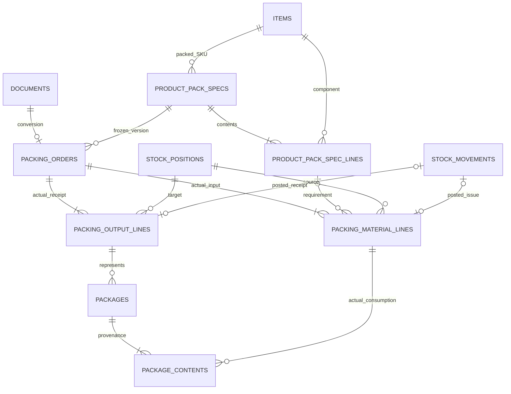

Packing receives PACK lots; full recovery receives component lots without new
containers. Existing cost links connect both to Production/Processing/source lots.
Historical/current costs remain derived from posted entries, not new cost masters.

## Implemented Phase 9 relationships (2026-10-26)

These edges are actual FKs in the additive Production migration. The detailed
columns remain in [database/INVENTORY_PRODUCTION.md](database/INVENTORY_PRODUCTION.md).
Older statements that all Production is future scope are superseded.

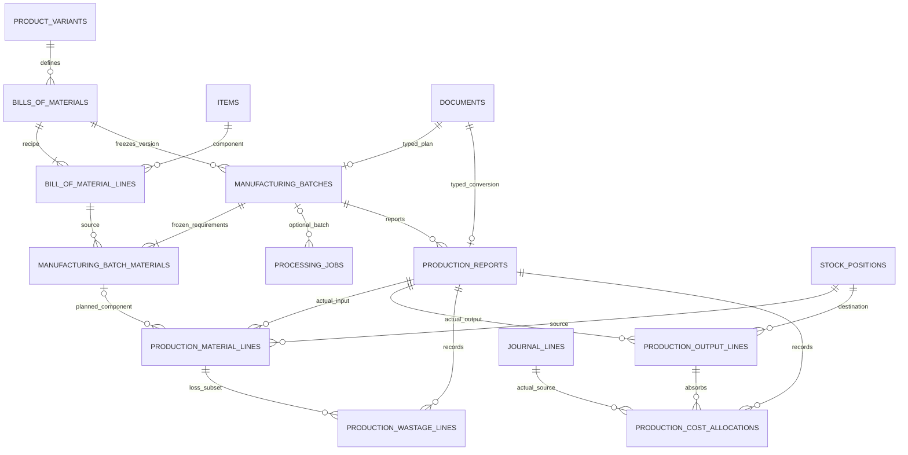

A completion-only final report legitimately has zero lines; ordinary conversions
require inputs and outputs. Stock movement/FIFO/value/cost-link relationships reuse
the existing ledger. Posted report effects are not a second inventory ledger.

> Phase 8 implementation (2026-10-21): configurable processing routes/jobs,
> contractor dispatch/custody, partial accepted/rejected returns, loss costing,
> roll lineage and exact-rate contractor bill/AP sources are implemented.
> See [PROCESSING.md](PROCESSING.md) for actual behavior and explicit boundaries.
> Production/sales/payments/tax remain future scope; MySQL 8.4 validation is pending.

Logical relationship views for the approved Phase 1 architecture. They omit some
columns and cardinalities for readability; the detailed table specifications are
authoritative. An ERD edge means a direct FK unless described as a service
invariant in [DATABASE_SCHEMA](DATABASE_SCHEMA.md).

## Implemented Phase 5 textile catalog

Phase 5 implements the catalog relationships shown below. Collections are
labels on designs.season, not a new FK target. The existing shared `units` table
is reused. The warehouse/core inventory and minimum journal diagrams are implemented in Phase 6; the Purchasing and Processing slices are implemented in Phases 7-8; other operational-domain diagrams remain approved design only.

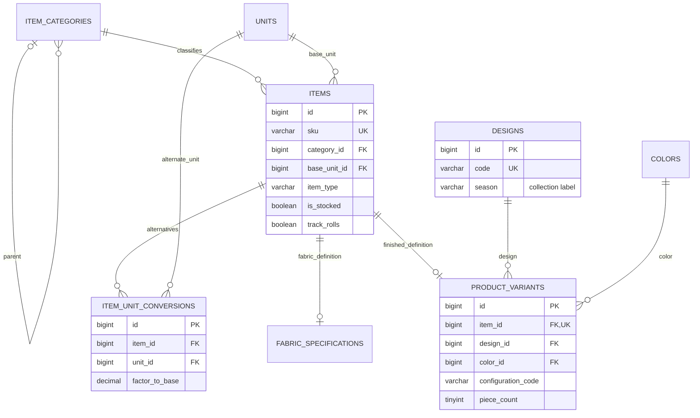

The composite variant business key is (design_id,color_id,configuration_code).
An ordinary FK cannot prove that item_id is a finished whole-suit item; the
CatalogService enforces that invariant transactionally. No quantity is stored
on these masters.

## Cross-module workflow

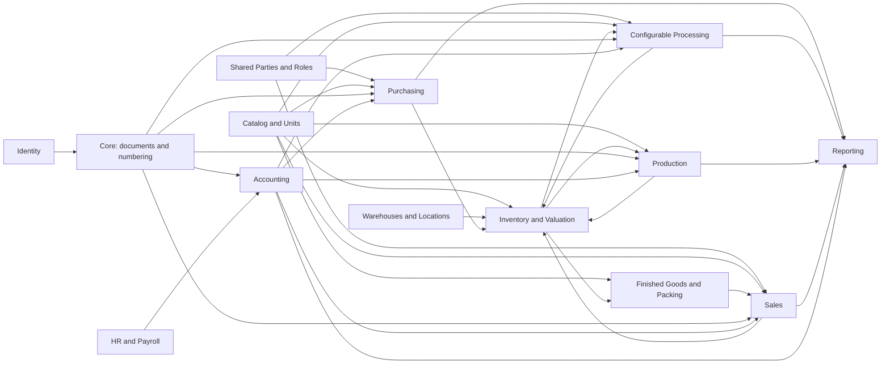

## Implemented Phase 3 setup and authorization relationships

The currency table is a PKR-only extension requested for Phase 3. Company is a
singleton, so settings have no repeated company ID. The optional `audit_events`
document FK is deferred until the document root is implemented.

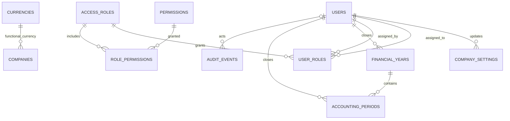

## Company identity, shared parties and catalog

The shared party identity and profiles below are implemented by Phase 4. A
profile is keyed by its `party_roles` row; vendor capabilities/rates sit beneath
the vendor role. The service validates that a role type agrees with its profile.

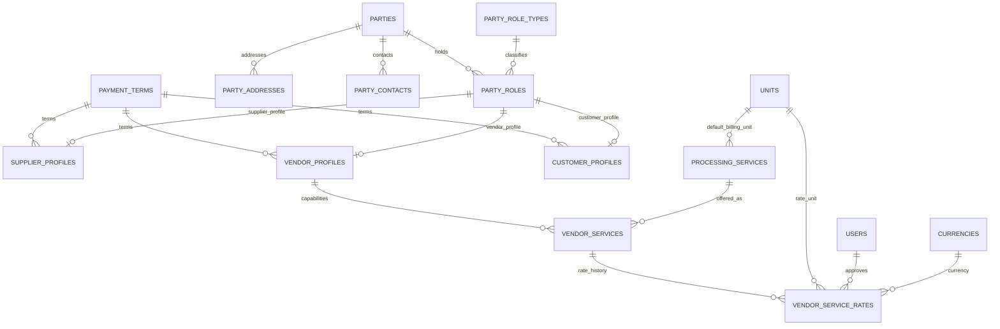

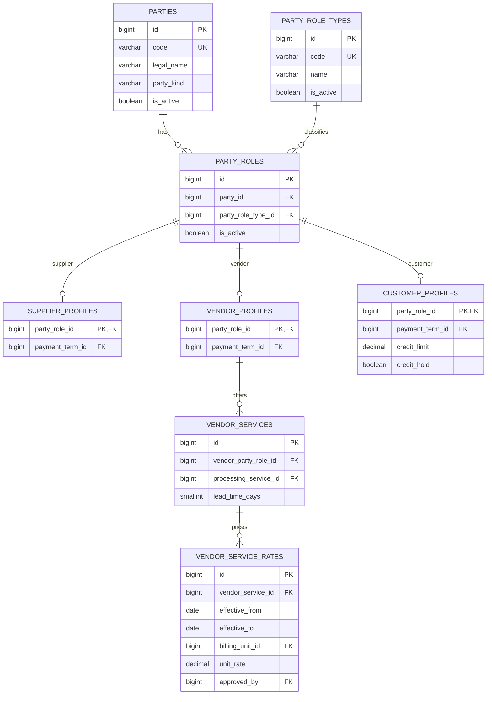

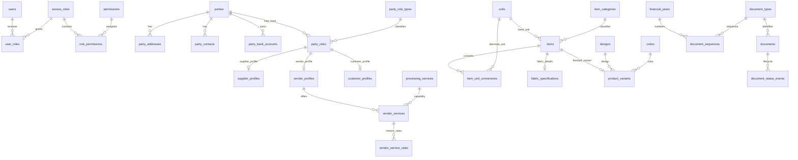

Profiles refer to role rows, not independent party records. One party can have
supplier, vendor and customer roles at once. Employee identity separately reuses
`parties` without requiring a commercial role.

## Warehouses, custody, inventory and valuation

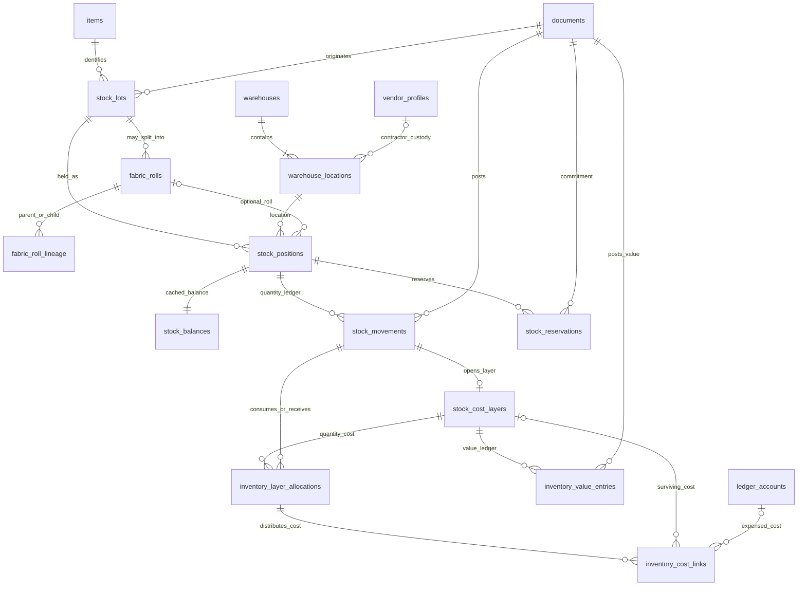

`stock_balances` and remaining layer quantities are projections; signed movement,
allocation and value rows carry the history. A contractor location changes custody
while the company remains the owner.

## Configurable processing and contractor custody

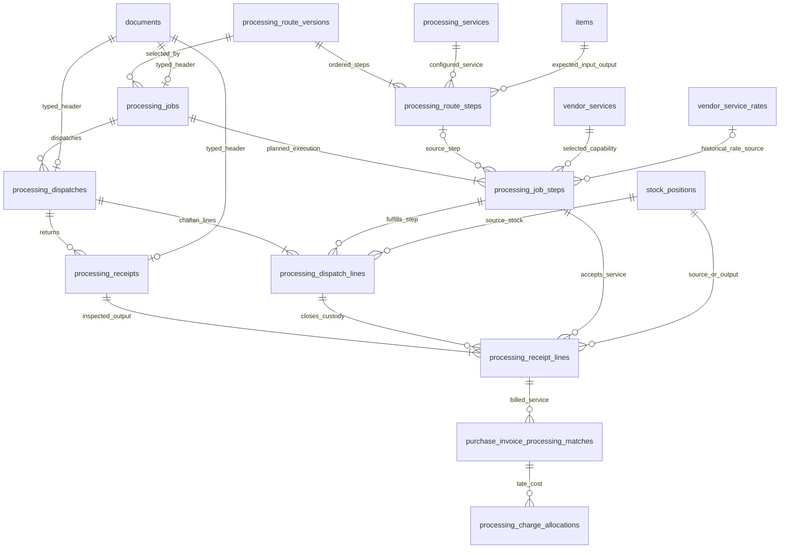

Route steps are configuration, not a fixed sequence in application code. The
job snapshots accepted vendor, effective service rate and units; physical challan
and acceptance quantities remain independently traceable.

## Production, finished suits and packing

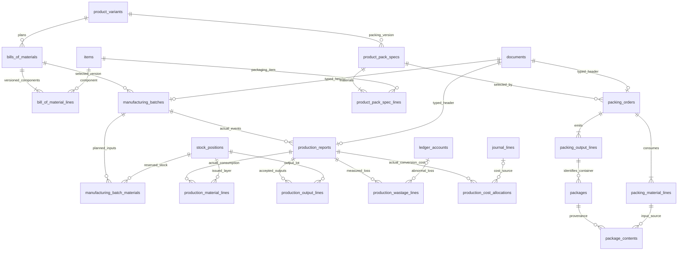

Material lines record actual input; output lines record good suit/package output.
The same inventory quantity and cost ledgers track components and finished goods.
Packages are container/provenance records and cannot duplicate stock quantity.

## Accounting and commercial relationships

Purchasing, Sales, journals, open-item settlements, bank reconciliation and
payroll have separate detailed ERDs in
[database/FINANCE_ERD](database/FINANCE_ERD.md). Their central path is:

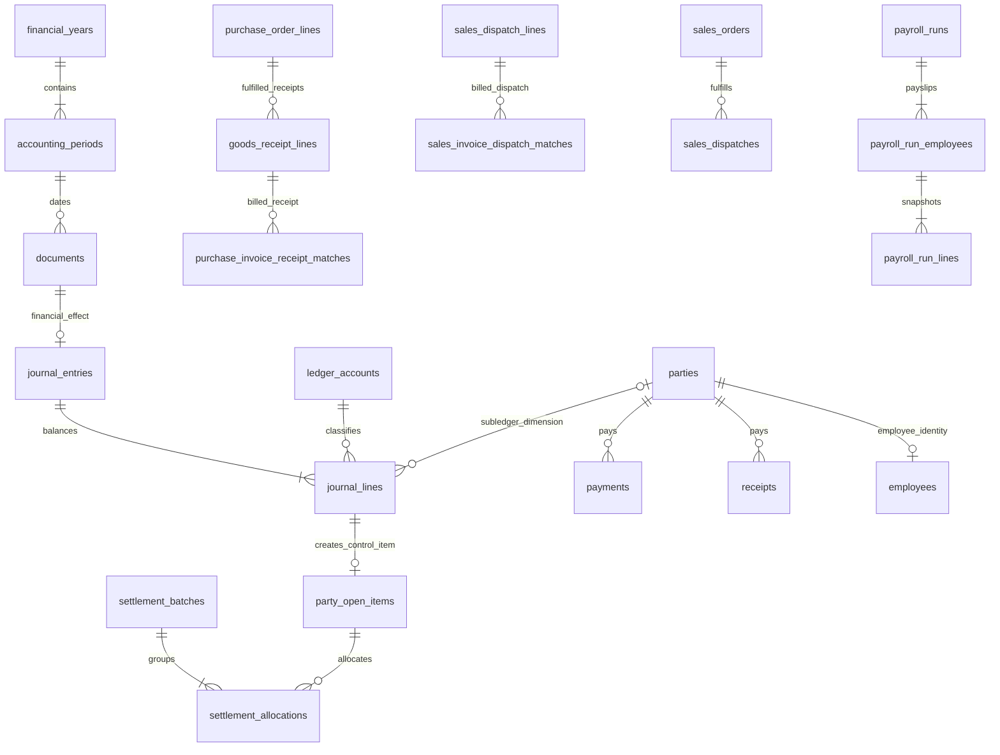

The full 55-table finance inventory and all diagram details are in the linked
finance ERD and specification. Cross-row balancing and party consistency remain
transaction invariants, not edges inferable from a simplified diagram.

## Phase 6 implemented dependency slice

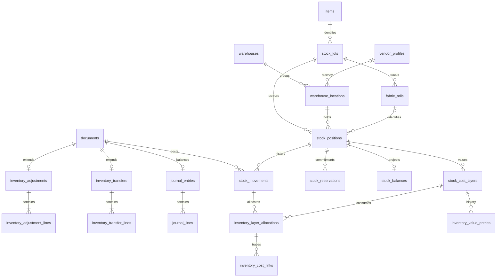

Reservations commit draft transfers in Phase 6. Employee dimensions are NULL-only
until a later employee FK migration; payroll/party open items are not implemented.

## Phase 7 implemented purchasing relationships

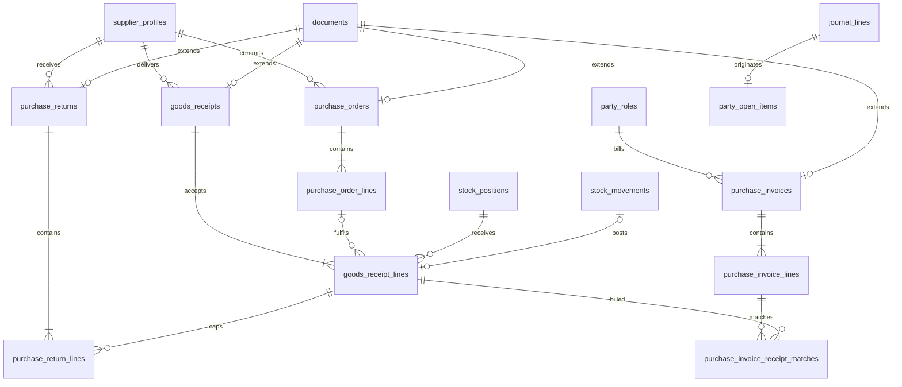

Future tax/processing dimension FKs are not shown: values are constrained NULL
until those prerequisite tables are authorized. Supplier identity still belongs
to parties; profiles are role-specific extensions, not duplicated masters.

## Implemented Phase 8 processing slice

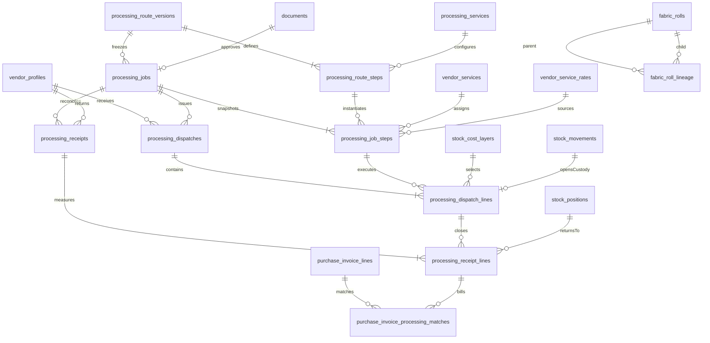

Each dispatch line's contractor movement opens one cost layer. Receipt source
allocations consume that exact layer (service invariant), preserving job custody
when several jobs share a stock position. Document/FIFO/journal relationships
shown in earlier diagrams are reused. processing_charge_allocations remains a
future late-cost integration table, not part of this executable slice.
