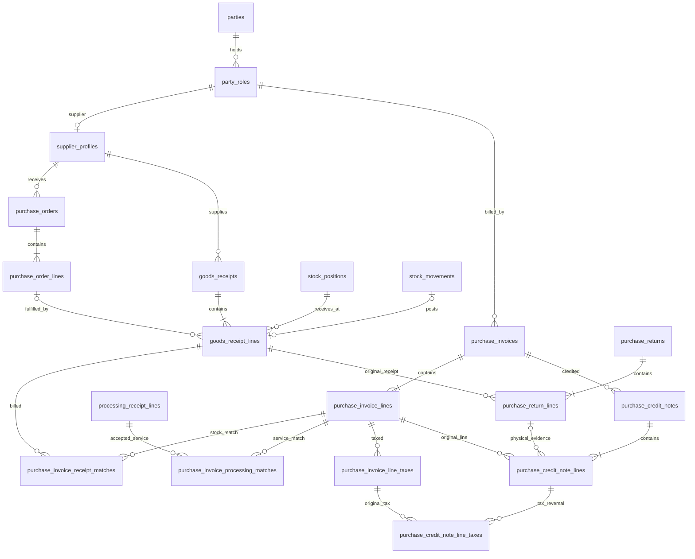
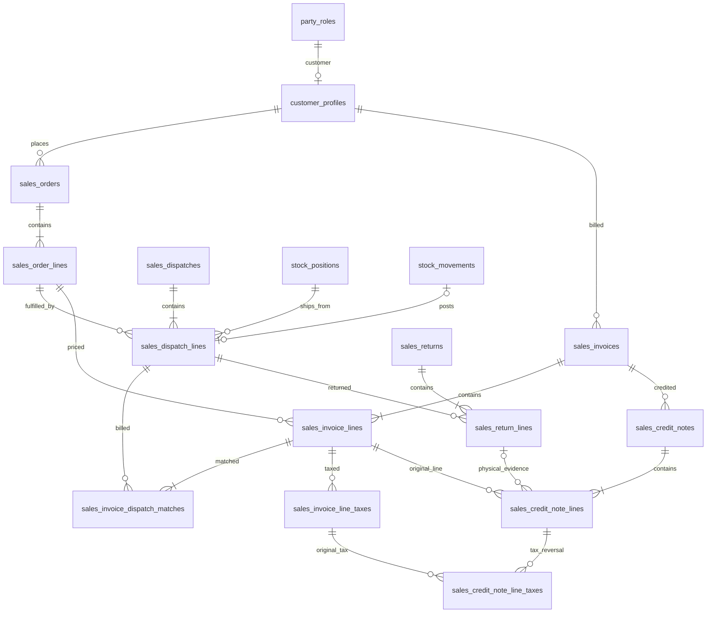
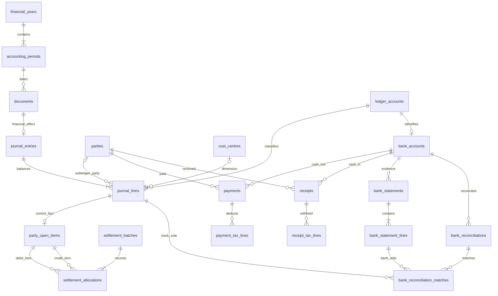
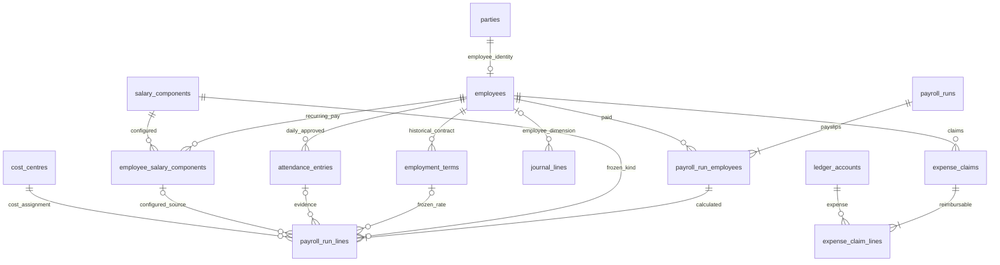

# Commercial and finance relationship diagrams

> Phase 8 now implements contractor processing bill matches and shared payable
> source journals. See [PROCESSING.md](../PROCESSING.md) for the executable
> subset and limits; the remaining finance diagrams describe approved design.

These Mermaid diagrams are logical relationship views. Exact FK nullability, uniqueness and types are in [COMMERCIAL_FINANCE.md](COMMERCIAL_FINANCE.md).

## Purchasing and payables

## Sales and receivables

## Journal, settlement and banking

## Payroll and expenses

